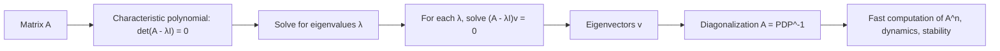

# SPL Run: build_concept_book

- **Adapter:** claude_cli
- **Model:** claude-sonnet-5
- **Tokens:** 1048 in / 617 out
- **Latency:** 19229ms
- **Timestamp:** 2026-11-23 17:49:53

## Output

```output


---

## Eigenvalue Eigenvector Linear Transformation

**Definition.** Let $T: V \to V$ be a linear transformation on a vector space $V$. A nonzero vector $v \in V$ is an **eigenvector** of $T$ if there exists a scalar $\lambda$ such that
$$
T(v) = \lambda v.
$$
The scalar $\lambda$ is the corresponding **eigenvalue**. Geometrically, $T$ does not rotate or distort $v$ — it only stretches, shrinks, or flips it along the same line. For a matrix representation $A$ of $T$ (relative to some basis), the condition becomes $Av = \lambda v$, equivalently $(A - \lambda I)v = 0$. Since $v \neq 0$, this forces $A - \lambda I$ to be singular, so eigenvalues are exactly the roots of the **characteristic polynomial**
$$
\det(A - \lambda I) = 0.
$$

**Worked example.** Let $A = \begin{pmatrix} 2 & 1 \\ 1 & 2 \end{pmatrix}$. The characteristic equation is
$$
\det\begin{pmatrix} 2-\lambda & 1 \\ 1 & 2-\lambda \end{pmatrix} = (2-\lambda)^2 - 1 = \lambda^2 - 4\lambda + 3 = 0,
$$
giving $\lambda_1 = 1$, $\lambda_2 = 3$. For $\lambda_1 = 1$: solve $(A - I)v = 0$, i.e. $\begin{pmatrix}1 & 1\\ 1 & 1\end{pmatrix}v = 0$, yielding $v_1 = (1, -1)$. For $\lambda_2 = 3$: $\begin{pmatrix}-1 & 1\\ 1 & -1\end{pmatrix}v = 0$, yielding $v_2 = (1, 1)$. Check: $Av_2 = (2+1, 1+2) = (3,3) = 3v_2$. ✓

**Problem-solving application.** Eigenvalues/eigenvectors let you decouple a coupled system into independent scalar behaviors. If $A$ is diagonalizable, write $A = PDP^{-1}$ where columns of $P$ are eigenvectors and $D = \text{diag}(\lambda_1, \lambda_2, \dots)$. Then $A^n = PD^nP^{-1}$, turning an otherwise expensive repeated matrix multiplication into raising scalars to a power — essential for solving systems of linear differential equations, analyzing long-run behavior of Markov chains, and computing population or financial growth models iterated many steps into the future. The key diagnostic skill: once you find $\lambda$, finding $v$ is just solving a homogeneous linear system $(A-\lambda I)v=0$, which you already know how to do via row reduction.


*How eigenvalues and eigenvectors are computed from a matrix and then used to simplify repeated transformations.*
```
