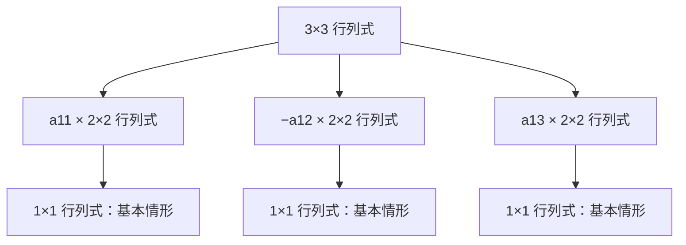
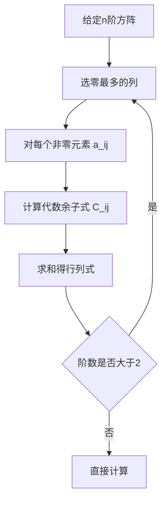
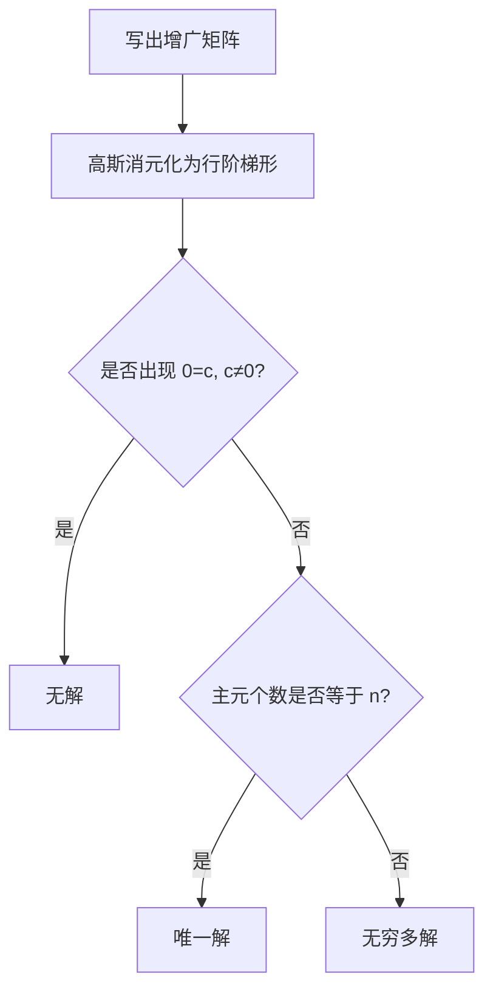
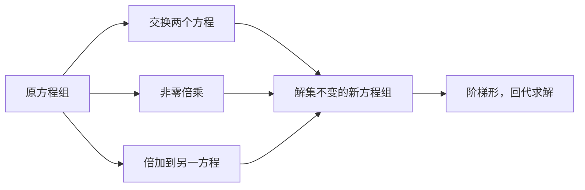
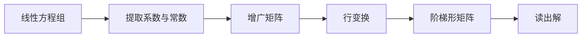
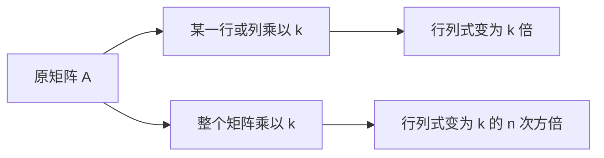
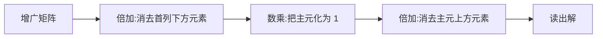

# SPL Run: build_concept_book

- **Adapter:** claude_cli
- **Model:** claude-sonnet-5-5
- **Tokens:** 17306 in / 6546 out
- **Latency:** 247733ms
- **Timestamp:** 2026-11-24 07:22:15

## Output

```output


---

## 方阵

**定义。** 若一个矩阵的行数与列数相等,即 $m=n$,则称它为 $n$ 阶**方阵**,记作 $A\in\mathbb{R}^{n\times n}$。只有方阵才有以下概念:

- **主对角线**:元素 $a_{11},a_{22},\dots,a_{nn}$;
- **迹**:$\operatorname{tr}(A)=\sum_{i=1}^{n}a_{ii}$;
- **行列式** $\det(A)$、**逆矩阵** $A^{-1}$、**特征值**与**特征向量**;
- **幂**:$A^k=\underbrace{A\cdots A}_{k\text{ 个}}$(因为 $A$ 的列数等于行数,自己才能与自己相乘)。

单位矩阵 $I$ 是方阵的"乘法单位元":对任意 $n$ 阶方阵 $A$,有 $AI=IA=A$。

**为什么方阵特殊?** 一个 $n\times n$ 矩阵对应一个从 $\mathbb{R}^n$ 到自身的线性变换,即在同一空间内"变形"(旋转、拉伸、剪切等)。因此可以问:变换后空间的体积变化了多少?($|\det A|$)哪些方向只被拉伸而不改变方向?(特征向量)

**例题。** 设
$$A=\begin{pmatrix}2&1\\1&3\end{pmatrix}.$$

1. 迹:$\operatorname{tr}(A)=2+3=5$。
2. 行列式:$\det(A)=2\cdot3-1\cdot1=5$。
3. 逆矩阵:因为 $\det(A)\neq0$,
$$A^{-1}=\frac{1}{5}\begin{pmatrix}3&-1\\-1&2\end{pmatrix}.$$
4. 平方:
$$A^2=\begin{pmatrix}5&5\\5&10\end{pmatrix}.$$

验证:$AA^{-1}=\frac15\begin{pmatrix}6-1&-2+2\\3-3&-1+6\end{pmatrix}=I$。

**问题求解应用。** 解线性方程组 $A\mathbf{x}=\mathbf{b}$,其中 $\mathbf{b}=(4,5)^T$。

由于 $A$ 是方阵且 $\det(A)=5\neq0$,方程有唯一解:
$$\mathbf{x}=A^{-1}\mathbf{b}=\frac15\begin{pmatrix}3\cdot4-1\cdot5\\-1\cdot4+2\cdot5\end{pmatrix}=\frac15\begin{pmatrix}7\\6\end{pmatrix}.$$

代回检验:$2\cdot\frac75+\frac65=4$,$\frac75+3\cdot\frac65=5$,成立。

这里体现了方阵的核心判据。对 $n$ 阶方阵,下列命题等价:

1. $\det(A)\neq0$;
2. $A$ 可逆;
3. $A\mathbf{x}=\mathbf{b}$ 对每个 $\mathbf{b}$ 有唯一解;
4. $A$ 的 $n$ 个列线性无关;
5. $0$ 不是 $A$ 的特征值。

若 $\det(A)=0$,则变换把空间"压扁"到更低维,方程要么无解,要么有无穷多解。

**小结。** 非方阵($m\neq n$)不能求行列式,也没有通常意义上的逆矩阵。方阵让"输入空间"与"输出空间"同维,所以才能比较、迭代($A^k$)和分解(如对角化 $A=PDP^{-1}$)。判断一个线性系统是否"恰好可解",第一步就是检查系数矩阵是否为方阵,再计算 $\det(A)$。

---

## 子矩阵(Submatrix)

**定义。** 设 $A$ 是一个 $n\times n$ 矩阵。删去第 $i$ 行和第 $j$ 列后,剩下的 $(n-1)\times(n-1)$ 矩阵称为 $A$ 的**子矩阵**,记作 $A(i|j)$。更一般地,从任意 $m\times n$ 矩阵中选取若干行和若干列,保留它们交叉处的元素,所得矩阵也叫子矩阵。本节只讨论"删去一行一列"这种形式。

它是行列式余子式展开的基本构件:元素 $a_{ij}$ 的**余子式**为 $M_{ij}=\det A(i|j)$,**代数余子式**为 $C_{ij}=(-1)^{i+j}M_{ij}$。

**例题。** 设
$$A=\begin{pmatrix}2&1&3\\0&-1&4\\5&2&1\end{pmatrix}.$$
求 $A(2|3)$ 和 $A(1|1)$。

- 删去第 2 行、第 3 列:
$$A(2|3)=\begin{pmatrix}2&1\\5&2\end{pmatrix}.$$
- 删去第 1 行、第 1 列:
$$A(1|1)=\begin{pmatrix}-1&4\\2&1\end{pmatrix}.$$

检验规则:保留的元素,其行号不等于 $i$,列号不等于 $j$,并且相对位置保持不变。

**问题求解应用。** 用第一行的代数余子式展开计算 $\det A$:
$$\det A=\sum_{j=1}^{3}(-1)^{1+j}a_{1j}\det A(1|j).$$

先写出三个子矩阵:
$$A(1|1)=\begin{pmatrix}-1&4\\2&1\end{pmatrix},\quad A(1|2)=\begin{pmatrix}0&4\\5&1\end{pmatrix},\quad A(1|3)=\begin{pmatrix}0&-1\\5&2\end{pmatrix}.$$

它们的行列式分别为
$$\det A(1|1)=-1-8=-9,\quad \det A(1|2)=0-20=-20,\quad \det A(1|3)=0+5=5.$$

代入展开式:
$$\det A=2\cdot(-9)-1\cdot(-20)+3\cdot 5=-18+20+15=17.$$

**为什么这样做有效?** 子矩阵把 $n$ 阶行列式化为 $n-1$ 阶行列式,这是一个递归结构:
$$\det A=\sum_{j=1}^{n}(-1)^{1+j}a_{1j}\det A(1|j).$$
递归直到 $1\times1$ 或 $2\times2$ 矩阵为止。可以沿任意一行或一列展开,所以应选零最多的一行或一列,这样可以省去许多子矩阵的计算。

子矩阵还用于求逆矩阵。伴随矩阵 $\operatorname{adj}(A)$ 的 $(i,j)$ 元素是 $C_{ji}$,当 $\det A\neq 0$ 时
$$A^{-1}=\frac{1}{\det A}\operatorname{adj}(A).$$

**常见错误。**
1. 删错行列:$A(i|j)$ 删的是第 $i$ 行、第 $j$ 列,不要把下标顺序弄反。
2. 忘记符号因子 $(-1)^{i+j}$。
3. 删除后改变了保留元素的相对顺序。

**小结。** 子矩阵 $A(i|j)$ 是删去一行一列后得到的低一阶矩阵。用它定义余子式,就能把高阶行列式化为低阶行列式来计算。

---

## 行列式的定义

**定义。** 行列式是一个把方阵 $A$ 映为一个标量 $\det(A)$ 的函数，通过递归方式定义：

- 当 $n=1$ 时，$A=[a]$，规定 $\det(A)=a$。
- 当 $n\ge 2$ 时，沿第一行展开：
$$
\det(A)=\sum_{j=1}^{n}(-1)^{1+j}\,a_{1j}\,\det(M_{1j}),
$$
其中 $M_{1j}$ 是划去 $A$ 的第 $1$ 行和第 $j$ 列后得到的 $(n-1)\times(n-1)$ 子矩阵（称为**余子阵**）。记 $C_{ij}=(-1)^{i+j}\det(M_{ij})$，称为元素 $a_{ij}$ 的**代数余子式**，则 $\det(A)=\sum_{j} a_{1j}C_{1j}$。

由此可得 $2\times 2$ 的公式：
$$
\det\begin{pmatrix}a&b\\c&d\end{pmatrix}=a\cdot d-b\cdot c=ad-bc.
$$

**例题。** 计算
$$
A=\begin{pmatrix}2&1&3\\0&4&-1\\5&2&1\end{pmatrix}.
$$
沿第一行展开，符号依次为 $+,-,+$：
$$
\det(A)=2\det\begin{pmatrix}4&-1\\2&1\end{pmatrix}-1\cdot\det\begin{pmatrix}0&-1\\5&1\end{pmatrix}+3\det\begin{pmatrix}0&4\\5&2\end{pmatrix}.
$$
分别计算：$4\cdot1-(-1)\cdot2=6$；$0\cdot1-(-1)\cdot5=5$；$0\cdot2-4\cdot5=-20$。于是
$$
\det(A)=2\cdot 6-1\cdot 5+3\cdot(-20)=12-5-60=-53.
$$


*图：行列式的递归结构——每个 $n$ 阶行列式拆成 $n$ 个 $(n-1)$ 阶行列式，直至降到 $1\times1$ 的基本情形。*

**问题求解应用。** 递归定义的威力在于：选择含零最多的行（或列）展开，可大幅减少计算量。事实上，沿任意一行或任意一列展开结果相同（拉普拉斯展开）：
$$
\det(A)=\sum_{j=1}^{n}a_{ij}C_{ij}\quad(\text{任意固定的 } i).
$$

**例。** 求
$$
B=\begin{pmatrix}3&0&2\\1&0&-4\\2&5&1\end{pmatrix}.
$$
第 $2$ 列只有一个非零元 $a_{32}=5$，沿第 $2$ 列展开，只需计算一项：
$$
\det(B)=5\cdot(-1)^{3+2}\det\begin{pmatrix}3&2\\1&-4\end{pmatrix}=-5\cdot(-12-2)=70.
$$

**注意。** 直接按定义递归展开需要约 $n!$ 次乘法，$n$ 较大时代价极高；实际计算时通常先用行变换化为三角矩阵（三角矩阵的行列式等于对角元之积）。但定义本身是理解行列式性质的基础：例如 $\det(A)\neq 0$ 当且仅当 $A$ 可逆。

**练习。** 用递归定义计算 $\det\begin{pmatrix}1&2&0\\3&1&4\\0&2&1\end{pmatrix}$，并换用第 $3$ 行展开验证结果一致。（答案：$-15$。）

---

## 按行展开计算行列式

**定义。** 设 $A=(a_{ij})$ 为 $n$ 阶方阵($n\ge 2$)。划去第 $i$ 行、第 $j$ 列后所得的 $n-1$ 阶子矩阵记为 $M_{ij}$,称 $M_{ij}$ 的行列式为元素 $a_{ij}$ 的**余子式**,并定义**代数余子式**

$$C_{ij}=(-1)^{i+j}\det M_{ij}.$$

**行展开定理。** 对任意固定的行号 $i$($1\le i\le n$),有

$$\det A=\sum_{j=1}^{n} a_{ij}\,C_{ij}=\sum_{j=1}^{n}(-1)^{i+j}a_{ij}\det M_{ij}.$$

也就是说,沿哪一行展开,结果都相同。通常教材只写 $i=1$ 的情形,但这个结论对每一行都成立。

**证明思路。** 把第 $i$ 行依次与上方相邻的行交换,共交换 $i-1$ 次,将它换到第 1 行。每次交换使行列式变号,所以 $\det A=(-1)^{i-1}\det A'$,其中 $A'$ 是换行后的矩阵。对 $A'$ 沿第 1 行展开,并注意 $A'$ 划去第 1 行、第 $j$ 列后的子矩阵恰好是 $M_{ij}$(其余各行的相对顺序没有改变)。于是

$$\det A=(-1)^{i-1}\sum_{j}(-1)^{1+j}a_{ij}\det M_{ij}=\sum_{j}(-1)^{i+j}a_{ij}\det M_{ij}.$$

**符号规律。** 符号 $(-1)^{i+j}$ 构成棋盘图案:

$$\begin{pmatrix}+&-&+\\-&+&-\\+&-&+\end{pmatrix}$$

**例题。** 计算

$$A=\begin{pmatrix}2&0&3\\1&4&0\\5&0&-1\end{pmatrix}.$$

第 2 行含有一个 0,第 1 行和第 3 行各含有一个 0。我们任选一行,但要选零最多、计算最省的行。这里每行都只有一个 0,取第 2 行展开:

$$\det A=-1\cdot\det\begin{pmatrix}0&3\\0&-1\end{pmatrix}+4\cdot\det\begin{pmatrix}2&3\\5&-1\end{pmatrix}-0\cdot(\cdots).$$

第一项中,子矩阵的第一列全为 0,行列式为 $0$。第二项为 $4\,(2\cdot(-1)-3\cdot5)=4\cdot(-17)=-68$。所以 $\det A=-68$。

验证:沿第 1 行展开,得 $2\,(4\cdot(-1)-0)-0+3\,(1\cdot 0-4\cdot 5)=-8-60=-68$,结果一致。

**问题求解应用。** 计算时的策略是:**选含零最多的行**,每个零元素都使一个 $(n-1)$ 阶行列式免于计算。例如

$$\det\begin{pmatrix}3&1&2\\0&0&5\\4&-2&1\end{pmatrix}$$

沿第 2 行展开,只剩一项:$(-1)^{2+3}\cdot5\cdot\det\begin{pmatrix}3&1\\4&-2\end{pmatrix}=-5\cdot(-10)=50$。

对于更大的矩阵,可先用行运算(加上另一行的倍数不改变行列式)在某一行制造更多的零,再沿该行展开。

**要点小结:**
- 任意一行都可展开,结果相同;
- 展开时不要漏掉符号 $(-1)^{i+j}$;
- 优先选择零多的行,以减少计算量。

---

## 转置矩阵的行列式

**定义。** 对任意 $n\times n$ 方阵 $A$,其转置 $A^{T}$ 满足 $(A^{T})_{ij}=A_{ji}$。核心结论是:

$$\det(A^{T})=\det(A).$$

也就是说,行列式在转置下保持不变。

**为什么成立。** 由莱布尼茨展开,
$$\det A=\sum_{\sigma\in S_n}\operatorname{sgn}(\sigma)\prod_{i=1}^{n}a_{i,\sigma(i)}.$$
对 $A^{T}$ 有
$$\det A^{T}=\sum_{\sigma\in S_n}\operatorname{sgn}(\sigma)\prod_{i=1}^{n}a_{\sigma(i),i}.$$
在每个乘积中,把因子按行号重新排列。令 $j=\sigma(i)$,则 $i=\sigma^{-1}(j)$,于是
$$\prod_{i=1}^{n}a_{\sigma(i),i}=\prod_{j=1}^{n}a_{j,\sigma^{-1}(j)}.$$
又因为 $\operatorname{sgn}(\sigma^{-1})=\operatorname{sgn}(\sigma)$,且 $\sigma\mapsto\sigma^{-1}$ 是 $S_n$ 上的一一对应,所以
$$\det A^{T}=\sum_{\tau\in S_n}\operatorname{sgn}(\tau)\prod_{j=1}^{n}a_{j,\tau(j)}=\det A.\qquad\blacksquare$$

**例题。** 设
$$A=\begin{pmatrix}2&1&0\\3&4&5\\1&0&6\end{pmatrix}.$$
沿第一行展开:
$$\det A=2(24-0)-1(18-5)+0=48-13=35.$$
其转置为
$$A^{T}=\begin{pmatrix}2&3&1\\1&4&0\\0&5&6\end{pmatrix}.$$
同样沿第一行展开:
$$\det A^{T}=2(24-0)-3(6-0)+1(5-0)=48-18+5=35.$$
两者相等,与定理一致。

**解题应用。** 这条性质的实际价值在于:**凡是关于“行”的行列式性质,对“列”同样成立。**

1. **列运算。** 已知交换两行,行列式变号;由此立即得到交换两列也使行列式变号。其证明只需:交换 $A$ 的两列,相当于交换 $A^{T}$ 的两行,而 $\det A=\det A^{T}$。
2. **按列展开。** 按第 $j$ 列展开 $A$,等价于按第 $j$ 行展开 $A^{T}$,因此可以选择零最多的行或列来简化计算。
3. **推论。** 若 $A$ 有两列成比例,或有一整列为零,则 $\det A=0$。
4. **与乘积性质结合。** 若 $Q$ 为正交矩阵,即 $Q^{T}Q=I$,则
$$(\det Q)^2=\det(Q^{T})\det(Q)=\det(I)=1,$$
故 $\det Q=\pm1$。这里正是用到了 $\det Q^{T}=\det Q$。

**练习。** 不展开计算,说明为什么 $\begin{pmatrix}1&2&3\\4&5&6\\7&8&9\end{pmatrix}$ 的行列式为 $0$。
提示:第三列减去第二列,恰好等于第二列减去第一列,所以三列线性相关。这是行相关的列版本,可由转置性质直接得到。

---

## 按列展开行列式

**定义。** 设 $A=(a_{ij})$ 为 $n$ 阶方阵,$M_{ij}$ 为删去第 $i$ 行、第 $j$ 列后所得的 $n-1$ 阶子式,$C_{ij}=(-1)^{i+j}M_{ij}$ 称为元素 $a_{ij}$ 的代数余子式。已知按第 $i$ 行展开:
$$\det A=\sum_{j=1}^{n} a_{ij}C_{ij}.$$

**定理(按列展开)。** 对任意固定的列 $j$,
$$\det A=\sum_{i=1}^{n} a_{ij}C_{ij}=a_{1j}C_{1j}+a_{2j}C_{2j}+\cdots+a_{nj}C_{nj}.$$

**证明。** 利用 $\det A=\det A^{T}$。记 $B=A^{T}$,则 $b_{ji}=a_{ij}$。删去 $B$ 的第 $j$ 行、第 $i$ 列,所得矩阵恰为删去 $A$ 的第 $i$ 行、第 $j$ 列所得矩阵的转置,而转置不改变行列式,故 $B$ 的相应余子式等于 $M_{ij}$,符号 $(-1)^{i+j}$ 也相同,因此 $B$ 的代数余子式 $C^{B}_{ji}=C_{ij}$。对 $B$ 按第 $j$ 行展开:
$$\det A=\det B=\sum_{i=1}^{n} b_{ji}C^{B}_{ji}=\sum_{i=1}^{n} a_{ij}C_{ij}.\ \blacksquare$$

**符号规律。** $(-1)^{i+j}$ 构成棋盘格:
$$\begin{pmatrix}+&-&+\\-&+&-\\+&-&+\end{pmatrix}$$

**例题。** 计算
$$A=\begin{pmatrix}2&1&0\\3&0&4\\1&0&5\end{pmatrix}.$$
第 2 列为 $(1,0,0)^T$,含两个零,选它展开:
$$\det A=a_{12}C_{12}=1\cdot(-1)^{1+2}\begin{vmatrix}3&4\\1&5\end{vmatrix}=-(15-4)=-11.$$
只需计算一个 $2$ 阶子式。

**问题求解应用。** 求
$$D=\begin{vmatrix}1&2&0&3\\0&1&0&4\\2&5&3&1\\0&2&0&6\end{vmatrix}.$$
**策略:** 选零最多的列。第 3 列仅有 $a_{33}=3\neq0$,位置符号 $(-1)^{3+3}=+1$:
$$D=3\begin{vmatrix}1&2&3\\0&1&4\\0&2&6\end{vmatrix}.$$
再按第 1 列展开,仅剩 $a_{11}=1$:
$$D=3\cdot1\cdot\begin{vmatrix}1&4\\2&6\end{vmatrix}=3(6-8)=-6.$$

**要点。**
1. 行与列地位对称,哪一行或列零最多就选哪一个,可显著减少运算量。
2. 先用初等行(列)变换在某列制造零,再展开,是计算高阶行列式的常用手段。
3. 展开时务必核对 $(-1)^{i+j}$ 的符号,这是最常见的错误来源。


*图:按列展开的递归求解流程,每次展开使阶数降低一阶。*

---

## 线性方程

**定义。** 线性方程是只含有变量的加法以及变量与常数相乘的方程,其一般形式为

$$a_1x_1 + a_2x_2 + \cdots + a_nx_n = b,$$

其中 $a_1,\dots,a_n$ 是常数(称为系数),$b$ 是常数项,$x_1,\dots,x_n$ 是未知量。"线性"的含义是:每个变量都只以一次幂出现,变量之间没有乘积,也没有指数、根号或超越函数(如 $\sin x$、$e^x$、$\ln x$)。

下面几个例子可以帮助判断:

- $3x - 2y = 7$ 是线性方程。
- $x^2 + y = 1$ 不是线性方程,因为含有 $x^2$。
- $xy + z = 4$ 不是线性方程,因为含有变量的乘积 $xy$。
- $\sin x + y = 0$ 不是线性方程,因为含有超越函数。

**几何意义。** 含两个未知量的线性方程 $ax+by=c$($a,b$ 不全为零)的解集是平面上的一条直线。含三个未知量时,解集是空间中的一个平面。一般地,$n$ 个未知量的线性方程的解集是 $n$ 维空间中的一个"超平面"。

**例题。** 求方程 $2x + 3y = 12$ 的所有解。

解:把 $y$ 用 $x$ 表示出来:

$$y = \frac{12 - 2x}{3} = 4 - \frac{2}{3}x.$$

$x$ 可以任取。令 $x = t$($t$ 为任意实数),则解可写成

$$(x, y) = \left(t,\; 4 - \tfrac{2}{3}t\right).$$

例如 $t=0$ 得 $(0,4)$,$t=3$ 得 $(3,2)$。代入验证:$2\cdot 3 + 3\cdot 2 = 12$,成立。这说明单个线性方程若含两个未知量,就有无穷多个解,它们恰好落在一条直线上。其中的 $t$ 称为自由参数。

**应用问题。** 某咖啡店用甲、乙两种豆子拌成配方。甲豆每千克 40 元,乙豆每千克 60 元。现有预算 600 元,最多能买多少乙豆?有哪些购买方案?

建模:设买甲豆 $x$ 千克,乙豆 $y$ 千克,则

$$40x + 60y = 600.$$

化简(两边除以 20)得 $2x + 3y = 30$。由于重量不能为负,需要 $x \ge 0,\ y \ge 0$。

- 若只买乙豆,令 $x=0$,得 $y=10$,所以乙豆最多 10 千克。
- 若只买甲豆,令 $y=0$,得 $x=15$。
- 若要求两种豆子重量相等,令 $x=y$,得 $5x=30$,所以 $x=y=6$ 千克。

可见,线性方程的解集在实际问题中通常还要受到现实约束(这里是非负性)的限制,最后得到的是直线上的一段线段,而不是整条直线。

**要点小结。** 判断是否线性,只需检查三点:变量是否都是一次幂、变量之间是否无乘积、是否无超越函数。求解时,先选出若干个变量作为自由参数,再用它们表示其余变量。这一思路正是后面求解线性方程组的基础。

---

## 线性方程组

### 定义

**线性方程组**是由 $m$ 个线性方程组成、且共用同一组 $n$ 个未知数 $x_1,\dots,x_n$ 的集合:

$$
\begin{cases}
a_{11}x_1+a_{12}x_2+\cdots+a_{1n}x_n=b_1\\
a_{21}x_1+a_{22}x_2+\cdots+a_{2n}x_n=b_2\\
\quad\vdots\\
a_{m1}x_1+a_{m2}x_2+\cdots+a_{mn}x_n=b_m
\end{cases}
$$

其中 $a_{ij}$ 为系数,$b_i$ 为常数项。它可以写成矩阵形式 $A\mathbf{x}=\mathbf{b}$,其中 $A=(a_{ij})\in\mathbb{R}^{m\times n}$。**解**是同时满足所有方程的向量 $\mathbf{x}=(x_1,\dots,x_n)^T$。

方程组的解只有三种情形:**唯一解**、**无穷多解**、**无解**。(几何上,二元情形对应平面内若干直线相交于一点、重合、或互相平行。)

判定依据:设增广矩阵为 $[A\mid\mathbf{b}]$,则

- 若 $\operatorname{rank}(A)<\operatorname{rank}([A\mid\mathbf{b}])$,方程组无解;
- 若 $\operatorname{rank}(A)=\operatorname{rank}([A\mid\mathbf{b}])=n$,有唯一解;
- 若 $\operatorname{rank}(A)=\operatorname{rank}([A\mid\mathbf{b}])<n$,有无穷多解,且自由变量个数为 $n-\operatorname{rank}(A)$。

### 例题

求解
$$
\begin{cases}
x+y+z=6\\
2x-y+z=3\\
x+2y-z=2
\end{cases}
$$

写出增广矩阵并做高斯消元:

$$
\left[\begin{array}{ccc|c}1&1&1&6\\2&-1&1&3\\1&2&-1&2\end{array}\right]
\xrightarrow{R_2-2R_1,\;R_3-R_1}
\left[\begin{array}{ccc|c}1&1&1&6\\0&-3&-1&-9\\0&1&-2&-4\end{array}\right]
$$

交换并消元:$R_2\leftrightarrow R_3$,再 $R_3+3R_2$,得

$$
\left[\begin{array}{ccc|c}1&1&1&6\\0&1&-2&-4\\0&0&-7&-21\end{array}\right]
$$

回代:$z=3$;$y-2z=-4\Rightarrow y=2$;$x+y+z=6\Rightarrow x=1$。

验算第二式:$2(1)-2+3=3$ ✓。故唯一解为 $(x,y,z)=(1,2,3)$。

### 问题求解应用

**问题:** 当 $k$ 取何值时,方程组
$$
\begin{cases}
x+y=2\\
2x+2y=k
\end{cases}
$$
无解?有无穷多解?

**解:** 增广矩阵为 $\left[\begin{array}{cc|c}1&1&2\\2&2&k\end{array}\right]$,做 $R_2-2R_1$:

$$
\left[\begin{array}{cc|c}1&1&2\\0&0&k-4\end{array}\right]
$$

- 当 $k\neq4$ 时,第二行表示 $0=k-4\neq0$,矛盾,故 $\operatorname{rank}(A)=1<\operatorname{rank}([A\mid\mathbf{b}])=2$,**无解**(两直线平行)。
- 当 $k=4$ 时,两方程等价,$\operatorname{rank}(A)=\operatorname{rank}([A\mid\mathbf{b}])=1<2$,有 $2-1=1$ 个自由变量。令 $y=t$,则 $x=2-t$,**无穷多解**:$(x,y)=(2-t,\,t)$,$t\in\mathbb{R}$(两直线重合)。

**解题策略小结:**

1. 写出增广矩阵 $[A\mid\mathbf{b}]$;
2. 用初等行变换化为行阶梯形;
3. 先检查是否出现形如 $0=c\ (c\neq0)$ 的行(无解);
4. 否则数主元个数,与 $n$ 比较,判断唯一解或含自由变量的无穷多解;
5. 回代求解并代回原方程验算。


*图:利用高斯消元判断线性方程组解的情形的决策流程。*

---

## 方程的初等运算

### 定义

解线性方程组时，我们希望把方程组化简为容易读出答案的形式。下面三种运算称为**初等运算**（初等行变换作用于方程）：

1. **交换**：交换任意两个方程的位置；
2. **倍乘**：用一个**非零**常数 $c$ 乘以某个方程的两边；
3. **倍加**：把某个方程的 $c$ 倍加到另一个方程上（$c$ 可为任意实数）。

**核心性质**：每一种运算都不改变方程组的解集。

**为什么成立？** 前两种运算显然可逆：交换两次回到原状；乘以 $c\neq 0$ 后再乘以 $\frac{1}{c}$ 即还原。对倍加运算，设方程组含 $E_i$ 与 $E_j$，将 $E_i$ 替换为 $E_i + cE_j$。若 $(x_1,\dots,x_n)$ 满足原方程组，则它同时满足 $E_i$ 与 $E_j$，因而满足两者的线性组合 $E_i+cE_j$。反过来，新方程组再作一次"加 $-c$ 倍的 $E_j$"就得到原方程组，所以新方程组的解也是原方程组的解。两个解集互相包含，故相等。

> 注意：倍乘必须要求 $c\neq 0$。若取 $c=0$，方程变为 $0=0$，信息丢失，解集可能变大。

### 例题

解方程组
$$
\begin{cases}
2y + z = 4 & (E_1)\\
x + y + z = 6 & (E_2)\\
2x + 3y + z = 11 & (E_3)
\end{cases}
$$

**步骤 1（交换）**：交换 $E_1,E_2$，使首项含 $x$：
$$
\begin{cases} x+y+z=6\\ 2y+z=4\\ 2x+3y+z=11 \end{cases}
$$

**步骤 2（倍加）**：$E_3 \to E_3 - 2E_1$，消去 $x$：
$$
y - z = -1
$$

**步骤 3（倍加）**：用第二个方程消去第三个方程中的 $y$。先把 $y-z=-1$ 乘以 $-2$ 加到 $2y+z=4$ 上会改变主元位置；更直接的做法是 $E_2' \to E_2' - 2E_3'$：得 $3z = 6$，即 $z=2$。

**步骤 4（回代）**：由 $y - z=-1$ 得 $y=1$；由 $x+y+z=6$ 得 $x=3$。

解为 $(x,y,z)=(3,1,2)$。代入检验：$2\cdot1+2=4$ ✓，$3+1+2=6$ ✓，$6+3+2=11$ ✓。

### 问题求解应用

**策略**：从左到右逐列选取"主元"，用倍加运算消去其下方所有系数；若主元位置为零，先用交换换入非零系数；若想简化数字，可用倍乘把主元变为 $1$。这正是高斯消元法的核心。

**练习**：用初等运算解
$$
\begin{cases} 2x + 4y = 10\\ x + 3y = 7 \end{cases}
$$

*解答*：倍乘 $\frac12 E_1$ 得 $x+2y=5$；倍加 $E_2 \to E_2 - E_1$ 得 $y=2$；回代得 $x=1$。解为 $(1,2)$。

**判断题**：把 $E_1$ 替换为 $E_1 + 3E_1$ 是否合法？这等价于 $E_1$ 乘以 $4$，合法。但把 $E_1$ 替换为 $E_1 - E_1$ 等价于乘以 $0$，**不合法**——因此倍加时，被加的方程必须是**另一个**方程，且被修改的方程本身的系数不能被"清零"。


*三种初等运算都把方程组变为同解方程组，反复使用即可化为阶梯形并求解。*

---

## 矩阵

**定义。** 一个 $m\times n$ 矩阵是由数排成 $m$ 行、$n$ 列的矩形数组,记作 $A=(a_{ij})$,其中 $a_{ij}$ 位于第 $i$ 行第 $j$ 列。它的"大小"(或"型")写作 $m\times n$。当 $m=n$ 时称为方阵。

矩阵最常见的用途,是把线性方程组的系数和常数项整齐地记录下来。对于方程组

$$
\begin{cases}
a_{11}x_1+a_{12}x_2+\cdots+a_{1n}x_n=b_1\\
\quad\vdots\\
a_{m1}x_1+a_{m2}x_2+\cdots+a_{mn}x_n=b_m
\end{cases}
$$

**系数矩阵**为 $A=(a_{ij})$,把常数列 $\mathbf b$ 并在右侧,就得到**增广矩阵** $[A\mid \mathbf b]$。这样,方程组可以紧凑地写成 $A\mathbf x=\mathbf b$。


*图:从方程组到矩阵,再通过行变换求解的流程。*

**例题。** 把方程组
$$
\begin{cases}
x+2y=5\\
3x+4y=11
\end{cases}
$$
写成增广矩阵:
$$
\left[\begin{array}{cc|c}1&2&5\\3&4&11\end{array}\right].
$$
这是一个 $2\times 3$ 矩阵(系数部分为 $2\times 2$)。每一行对应一个方程,每一列对应一个未知数(最后一列对应常数项)。

**问题求解应用。** 用行变换(交换两行、某行乘非零常数、把某行的倍数加到另一行)化简。将第 2 行减去 3 倍的第 1 行:
$$
\left[\begin{array}{cc|c}1&2&5\\0&-2&-4\end{array}\right].
$$
将第 2 行除以 $-2$,得 $y=2$:
$$
\left[\begin{array}{cc|c}1&2&5\\0&1&2\end{array}\right].
$$
再将第 1 行减去 2 倍的第 2 行:
$$
\left[\begin{array}{cc|c}1&0&1\\0&1&2\end{array}\right].
$$
读出解:$x=1,\ y=2$。验证:$1+2\cdot2=5$,$3\cdot1+4\cdot2=11$,均成立。

行变换之所以可靠,是因为每一种变换都对应对方程组的一个可逆操作,不改变解集。这样,"解方程组"就变成了对数组做机械的、可由计算机执行的运算。

**要点。**
- 先确认矩阵的型 $m\times n$:行数对应方程个数,列数对应未知数个数(增广矩阵多一列)。
- 写增广矩阵时,缺项的系数要补 $0$。
- 对角线以下全为 $0$ 的阶梯形,便于由下往上回代求解。

**练习。** 把 $2x-y=3,\ x+y=3$ 写成增广矩阵,并用行变换求解。(答案:$x=2,\ y=1$。)

---

## 行列倍数与行列式

**定义。** 设 $A$ 是 $n\times n$ 矩阵。若把 $A$ 的某一行(或某一列)的每个元素都乘以标量 $k$,得到矩阵 $B$,则

$$\det B = k\,\det A.$$

这条性质说明:行列式对每一行(或每一列)是**线性**的。注意,它只对*单独一行(列)*成立。若把整个矩阵乘以 $k$,则每一行都被乘了一次,共 $n$ 次,所以 $\det(kA)=k^{n}\det A$。

**为什么成立。** 按第 $i$ 行做余子式展开:

$$\det A=\sum_{j=1}^{n} a_{ij}C_{ij}.$$

余子式 $C_{ij}$ 是划去第 $i$ 行后得到的,与第 $i$ 行的元素无关。把第 $i$ 行乘以 $k$,每个 $a_{ij}$ 变成 $ka_{ij}$,于是

$$\det B=\sum_{j=1}^{n} (k a_{ij})C_{ij}=k\sum_{j=1}^{n} a_{ij}C_{ij}=k\det A.$$

**例题。** 设
$$A=\begin{pmatrix}2&1\\3&4\end{pmatrix},\quad \det A=2\cdot4-1\cdot3=5.$$
把第一行乘以 $3$,得
$$B=\begin{pmatrix}6&3\\3&4\end{pmatrix},\quad \det B=6\cdot4-3\cdot3=15=3\cdot5.$$
结果与性质一致。

**问题求解应用一:提取公因子。** 计算
$$D=\begin{vmatrix}2&4&6\\1&5&2\\3&1&4\end{vmatrix}.$$
第一行有公因子 $2$,提出后:
$$D=2\begin{vmatrix}1&2&3\\1&5&2\\3&1&4\end{vmatrix}.$$
再用第 2、3 行减去第 1 行的适当倍数(这不改变行列式),把第一列化为 $(1,0,0)^T$:
$$D=2\begin{vmatrix}1&2&3\\0&3&-1\\0&-5&-5\end{vmatrix}=2\cdot\big(3\cdot(-5)-(-1)(-5)\big)=2\cdot(-20)=-40.$$

**问题求解应用二:比例与缩放。** 若 $A$ 为 $4\times4$ 矩阵且 $\det A=3$,则:

- 只把第 2 列乘以 $-2$:行列式变为 $-2\cdot 3=-6$;
- 把整个矩阵乘以 $2$:行列式变为 $2^{4}\cdot3=48$。

**判断要点。** 如果某一行(列)全为零,可以看作乘了 $k=0$,所以行列式为 $0$。如果某一行(列)乘了 $k$ 之后行列式变化的倍数不是 $k$,通常说明你同时改动了多行,或做了其他类型的运算。

**几何意义。** 在 $\mathbb{R}^2$ 中,$|\det A|$ 是以 $A$ 的两行为边的平行四边形的面积。把一条边拉长为 $k$ 倍而方向不变,面积自然变为 $|k|$ 倍;若 $k<0$,方向翻转,符号也随之改变。


*图:单独缩放一行(列)与缩放整个矩阵对行列式的不同影响。*

---

## 行列式的行(列)倍加变换

**定义。** 在 $n$ 阶方阵 $A$ 中,把第 $j$ 行的 $k$ 倍加到第 $i$ 行($i\neq j$),得到新矩阵 $A'$。记作 $r_i + k r_j$。对列同理,记作 $c_i + k c_j$。

**性质。** 倍加变换不改变行列式:
$$\det A' = \det A.$$

**证明。** 设 $A$ 的各行为 $\mathbf r_1,\dots,\mathbf r_n$。行列式关于每一行是线性的,所以
$$\det(\dots,\ \mathbf r_i + k\mathbf r_j,\ \dots,\ \mathbf r_j,\ \dots)
=\det(\dots,\mathbf r_i,\dots,\mathbf r_j,\dots)+k\det(\dots,\mathbf r_j,\dots,\mathbf r_j,\dots).$$
右端第二项的矩阵有两行相同。交换这两行,矩阵不变,而行列式变号,所以 $D=-D$,即 $D=0$。因此第二项为零,性质得证。列的情形可对 $A^{\mathsf T}$ 应用同样的论证,因为 $\det A^{\mathsf T}=\det A$。

*几何意义:* 在二维中,行向量张成平行四边形,$|\det A|$ 是它的面积。把 $\mathbf r_j$ 的倍数加到 $\mathbf r_i$,相当于沿 $\mathbf r_j$ 的方向"剪切"平行四边形。底边不变,高不变,所以面积不变。

**例题。** 计算
$$D=\begin{vmatrix}1&2&3\\2&5&7\\3&7&11\end{vmatrix}.$$

做 $r_2-2r_1$ 和 $r_3-3r_1$:
$$D=\begin{vmatrix}1&2&3\\0&1&1\\0&1&2\end{vmatrix}.$$
再做 $r_3-r_2$:
$$D=\begin{vmatrix}1&2&3\\0&1&1\\0&0&1\end{vmatrix}=1\cdot1\cdot1=1.$$
三次变换都是倍加变换,所以行列式的值始终没有变。上三角矩阵的行列式等于对角线元素之积。

**解题应用。** 倍加变换是化简行列式最常用的工具,因为它不引入符号变化,也不引入数乘因子。基本步骤如下:

1. 选一个含 $1$ 或便于消元的元素作主元。
2. 用倍加变换把主元所在列的其余元素化为 $0$。
3. 化成三角形(或按含零最多的行、列展开)后求值。

**练习。** 计算
$$\begin{vmatrix}2&1&1\\4&3&2\\6&4&5\end{vmatrix}.$$

*解:* 做 $r_2-2r_1$、$r_3-3r_1$,得
$$\begin{vmatrix}2&1&1\\0&1&0\\0&1&2\end{vmatrix}.$$
再做 $r_3-r_2$,得
$$\begin{vmatrix}2&1&1\\0&1&0\\0&0&2\end{vmatrix}=2\cdot1\cdot2=4.$$

**易错提醒。** 只有"把另一行的倍数加到这一行"才保持行列式不变。若把某行乘以 $k$ 后覆盖自身,例如 $r_i\to k r_i$,行列式会变为原来的 $k$ 倍。若交换两行,行列式变号。

---

## 行列式的行(列)交换

**定义。** 交换矩阵 $A$ 的任意两行(或任意两列),得到的新矩阵 $B$ 的行列式变号:

$$\det B = -\det A.$$

这是行列式的三条基本行变换性质之一(另两条是:某行乘以 $k$,行列式乘以 $k$;某行的倍数加到另一行,行列式不变)。

**为什么成立。** 行列式是各行的"交错多线性函数":若两行相同,则 $\det = 0$。设 $A$ 的第 $i$、$j$ 行分别为 $\mathbf r_i,\mathbf r_j$,把其他行固定,记 $D(\mathbf r_i,\mathbf r_j)$ 为行列式。由多线性与"两行相同则为零":

$$0 = D(\mathbf r_i+\mathbf r_j,\ \mathbf r_i+\mathbf r_j) = D(\mathbf r_i,\mathbf r_i)+D(\mathbf r_i,\mathbf r_j)+D(\mathbf r_j,\mathbf r_i)+D(\mathbf r_j,\mathbf r_j).$$

首尾两项为 $0$,故 $D(\mathbf r_i,\mathbf r_j) = -D(\mathbf r_j,\mathbf r_i)$,即交换两行使行列式变号。对列的结论可由 $\det A^{\mathsf T}=\det A$ 得到。

**例题。** 设
$$A=\begin{pmatrix}1&2\\3&4\end{pmatrix},\quad \det A = 1\cdot4-2\cdot3=-2.$$
交换两行得 $B=\begin{pmatrix}3&4\\1&2\end{pmatrix}$,
$$\det B = 3\cdot 2-4\cdot 1 = 2 = -\det A.$$
交换两列得 $C=\begin{pmatrix}2&1\\4&3\end{pmatrix}$,$\det C = 2\cdot3-1\cdot4=2$,同样变号。

**应用一:高斯消元求行列式。** 计算
$$M=\begin{vmatrix}0&2&1\\1&3&2\\2&1&4\end{vmatrix}.$$
左上角为 $0$,不能作主元,交换第 1、2 行(记一次变号):
$$M=-\begin{vmatrix}1&3&2\\0&2&1\\2&1&4\end{vmatrix}.$$
用 $R_3\to R_3-2R_1$(行列式不变):
$$M=-\begin{vmatrix}1&3&2\\0&2&1\\0&-5&0\end{vmatrix}.$$
再用 $R_3\to R_3+\tfrac52R_2$:第三行变为 $(0,0,\tfrac52)$,得上三角矩阵,行列式为对角线乘积 $1\cdot2\cdot\tfrac52=5$。所以
$$M=-5.$$

**应用二:推论。** 若矩阵有两行(或两列)相同,交换它们矩阵不变,故 $\det A=-\det A$,即 $\det A=0$。这给出判断矩阵不可逆的快速方法。

**要点与常见错误。** 若经过 $k$ 次行交换,则 $\det$ 乘以 $(-1)^k$:偶数次交换不改变符号,奇数次改变符号。用消元法时务必记录交换次数。另外注意:只有"交换"才变号,而"把一行的倍数加到另一行"不改变行列式,不要混淆。

**练习。** 已知 $\det\begin{pmatrix}a&b\\c&d\end{pmatrix}=5$,求 $\det\begin{pmatrix}b&a\\d&c\end{pmatrix}$。(答案:$-5$,因为交换了两列。)

---

## 上三角矩阵的行列式

**定义。** 若方阵 $A=(a_{ij})$ 满足：当 $i>j$ 时 $a_{ij}=0$（主对角线以下全为零），则称 $A$ 为**上三角矩阵**；当 $i<j$ 时 $a_{ij}=0$ 则称为**下三角矩阵**。

**定理。** 设 $A$ 是 $n\times n$ 的上三角（或下三角）矩阵，则
$$
\det A = a_{11}a_{22}\cdots a_{nn}=\prod_{i=1}^{n} a_{ii}.
$$

**证明（对 $n$ 归纳）。** $n=1$ 时显然成立。设结论对 $n-1$ 阶成立。将 $A$ 的行列式沿第一列展开：由于第一列除 $a_{11}$ 外全为零，所以
$$
\det A = a_{11}\cdot\det M_{11},
$$
其中 $M_{11}$ 是删去第 1 行、第 1 列后得到的 $n-1$ 阶子矩阵。$M_{11}$ 仍是上三角矩阵，其对角线为 $a_{22},\dots,a_{nn}$。由归纳假设，$\det M_{11}=a_{22}\cdots a_{nn}$，故结论成立。下三角的情形沿第一行展开，或利用 $\det A^{T}=\det A$ 即可。$\blacksquare$

### 例题

计算
$$
A=\begin{pmatrix}2 & 5 & -1\\ 0 & 3 & 4\\ 0 & 0 & -2\end{pmatrix}.
$$
$A$ 是上三角矩阵，所以
$$
\det A = 2\cdot 3\cdot(-2) = -12.
$$
若按定义用余子式展开，需要计算多个 $2\times2$ 行列式；利用本定理只需读出对角线并相乘。

### 问题求解中的应用

这个结论是**用高斯消元法计算行列式**的基础。其思路是：用行变换把 $A$ 化成上三角矩阵 $U$，同时记录行变换对行列式的影响：

- 交换两行：行列式变号；
- 某一行乘以非零常数 $c$：行列式乘以 $c$；
- 把一行的倍数加到另一行：行列式不变。

**例。** 求 $\det B$，其中
$$
B=\begin{pmatrix}0 & 2 & 1\\ 1 & 1 & 3\\ 2 & 0 & 4\end{pmatrix}.
$$
先交换第 1、2 行（符号 $-1$）：
$$
\begin{pmatrix}1 & 1 & 3\\ 0 & 2 & 1\\ 2 & 0 & 4\end{pmatrix}.
$$
再用 $R_3\to R_3-2R_1$（行列式不变）：
$$
\begin{pmatrix}1 & 1 & 3\\ 0 & 2 & 1\\ 0 & -2 & -2\end{pmatrix}.
$$
再用 $R_3\to R_3+R_2$：
$$
U=\begin{pmatrix}1 & 1 & 3\\ 0 & 2 & 1\\ 0 & 0 & -1\end{pmatrix}.
$$
因此
$$
\det B=(-1)\cdot\det U=(-1)\cdot(1\cdot 2\cdot(-1))=2.
$$

**推论。** 三角矩阵 $A$ 可逆当且仅当所有对角元 $a_{ii}\neq 0$。这是因为 $\det A\ne 0$ 等价于每个 $a_{ii}\neq0$。同时，这也说明三角矩阵的特征值就是它的对角元（因为 $\det(A-\lambda I)=\prod (a_{ii}-\lambda)$）。

**复杂度。** 直接余子式展开需要约 $n!$ 次运算，而消元化为三角形只需 $O(n^3)$ 次运算，这正是数值软件计算行列式的方法。

---

## 行初等变换

**定义。** 解线性方程组时,我们常对方程做三种不改变解集的操作。把它们作用在增广矩阵的行上,就得到三种**行初等变换**:

1. **交换**两行:$R_i \leftrightarrow R_j$;
2. **数乘**:把某一行乘以非零常数 $k$:$R_i \to kR_i$($k\neq 0$);
3. **倍加**:把某一行的 $k$ 倍加到另一行上:$R_i \to R_i + kR_j$($i\neq j$)。

这三种操作都**可逆**:交换两次回到原样;数乘 $k$ 之后再乘 $\tfrac1k$;倍加 $k$ 之后再加 $-k$ 倍。因此,经行初等变换得到的新增广矩阵所对应的方程组,与原方程组有**完全相同的解集**。这也说明为什么数乘时必须要求 $k\neq 0$:乘以 $0$ 会抹掉一个方程,且无法恢复。

**例题。** 解方程组
$$
\begin{cases}
x + 2y = 5\\
3x + 4y = 11
\end{cases}
\quad\Longrightarrow\quad
\left[\begin{array}{cc|c}1&2&5\\3&4&11\end{array}\right]
$$

第一步,消去第二行的 $x$ 项,用倍加 $R_2 \to R_2 - 3R_1$:
$$
\left[\begin{array}{cc|c}1&2&5\\0&-2&-4\end{array}\right]
$$
第二步,数乘 $R_2 \to -\tfrac12 R_2$:
$$
\left[\begin{array}{cc|c}1&2&5\\0&1&2\end{array}\right]
$$
第三步,倍加 $R_1 \to R_1 - 2R_2$:
$$
\left[\begin{array}{cc|c}1&0&1\\0&1&2\end{array}\right]
$$
读出结果:$x=1,\ y=2$。代入原方程验证:$1+4=5$,$3+8=11$,均成立。


*用行初等变换化简增广矩阵的基本流程。*

**问题求解应用。** 解题的通用策略是:从左到右逐列处理,每列先找一个非零元素作**主元**;若主元位置为 $0$,就用**交换**把非零行换上来;再用**数乘**把主元化为 $1$;最后用**倍加**把该列其余元素消为 $0$。

试解:
$$
\left[\begin{array}{cc|c}0&1&3\\2&4&6\end{array}\right]
$$
第一列左上角为 $0$,先交换 $R_1\leftrightarrow R_2$,得到 $\left[\begin{array}{cc|c}2&4&6\\0&1&3\end{array}\right]$;再 $R_1\to\tfrac12R_1$ 得 $\left[\begin{array}{cc|c}1&2&3\\0&1&3\end{array}\right]$;最后 $R_1\to R_1-2R_2$ 得 $\left[\begin{array}{cc|c}1&0&-3\\0&1&3\end{array}\right]$,即 $x=-3,\ y=3$。

**要点。** 三种变换只改变方程组的"写法",不改变它的解。熟练掌握它们,是后面学习高斯消元法、求逆矩阵与判断线性相关性的基础。

---

## 行列式的行化简计算法

### 定义

直接用余子式展开计算 $n$ 阶行列式需要约 $n!$ 次乘法，当 $n$ 较大时不可行。**行化简法**的思路是：通过初等行变换把矩阵化为上三角矩阵，再利用"三角矩阵的行列式等于对角线元素之积"，同时记录每一步行变换对行列式的影响。

三种初等行变换对 $\det A$ 的影响如下：

| 行变换 | 对行列式的影响 |
|---|---|
| 交换两行 $R_i \leftrightarrow R_j$ | 行列式变号，乘以 $-1$ |
| 某行乘以非零常数 $k$：$R_i \to kR_i$ | 行列式乘以 $k$ |
| 把一行的倍数加到另一行：$R_i \to R_i + cR_j$ | 行列式**不变** |

若 $A$ 经过 $s$ 次行交换、并且做了若干次倍乘（倍数为 $k_1,\dots,k_m$）后化为上三角矩阵 $U$，则

$$\det A = \frac{(-1)^s}{k_1 k_2\cdots k_m}\,\det U = \frac{(-1)^s}{k_1\cdots k_m}\,u_{11}u_{22}\cdots u_{nn}.$$

实际计算中，最好只使用第三种操作（以及必要的交换），这样就无需处理 $k_i$。

### worked example（例题）

计算
$$A=\begin{pmatrix}2&1&3\\4&5&4\\6&4&10\end{pmatrix}.$$

**第一步**：消去第一列。$R_2\to R_2-2R_1$，$R_3\to R_3-3R_1$（行列式不变）：
$$\begin{pmatrix}2&1&3\\0&3&-2\\0&1&1\end{pmatrix}.$$

**第二步**：$R_3\to R_3-\tfrac13R_2$（行列式不变）：
$$U=\begin{pmatrix}2&1&3\\0&3&-2\\0&0&\tfrac53\end{pmatrix}.$$

没有行交换，也没有倍乘，因此
$$\det A = 2\cdot 3\cdot\tfrac53 = 10.$$

### 问题解决应用

**例**：计算
$$B=\begin{pmatrix}0&2&1\\3&1&4\\1&5&2\end{pmatrix}.$$

左上角为 $0$，无法作主元，先交换 $R_1\leftrightarrow R_3$（$s=1$，记 $-1$）：
$$\begin{pmatrix}1&5&2\\3&1&4\\0&2&1\end{pmatrix}.$$
$R_2\to R_2-3R_1$：
$$\begin{pmatrix}1&5&2\\0&-14&-2\\0&2&1\end{pmatrix}.$$
$R_3\to R_3+\tfrac17R_2$：第三行变为 $\left(0,\,0,\,1-\tfrac27\right)=\left(0,0,\tfrac57\right)$。

于是
$$\det B=(-1)^1\cdot 1\cdot(-14)\cdot\tfrac57=10.$$

**检验**：按第一行展开，$\det B = 0 - 2(3\cdot2-4\cdot1)+1(3\cdot5-1\cdot1)=-4+14=10$。✓

**解题要点**：
1. 遇到主元为 $0$ 时，换下方一个非零行，并记录一次变号。
2. 若某列主元及其下方元素全为 $0$，则 $\det A=0$。
3. 复杂度：约 $\tfrac{n^3}{3}$ 次乘法，远小于 $n!$。例如 $n=10$ 时，前者约 $330$ 次，后者约 $3.6\times10^6$ 次。
4. 若手算想避免分数，可用倍乘，但务必在最后**除以**所乘的倍数，这是最常见的出错点。

---

## 回报(Payoff)

### 行化简究竟达成了什么

行化简求行列式,把一个看似需要 $n!$ 项求和的对象,变成了一次系统化的消元过程。其依据是三条行操作对行列式的影响:

- 交换两行:$\det$ 变号;
- 某行乘以非零常数 $c$:$\det$ 乘以 $c$;
- 把一行的倍数加到另一行:$\det$ 不变。

利用这些规则把 $A$ 化为上三角矩阵 $U$,则行列式等于对角线元素之积(再按所作操作修正符号与倍数):

$$\det A = (-1)^{s}\,\frac{u_{11}u_{22}\cdots u_{nn}}{c_1c_2\cdots c_k},$$

其中 $s$ 是行交换次数,$c_i$ 是所作的行缩放因子。若只用"加倍数"和"交换"两种操作,则无需除法,$\det A=(-1)^s\prod u_{ii}$。

**为什么它是自然的终点?** 它汇集了前面所学的全部内容:行操作的性质、三角矩阵的行列式、可逆性判据($\det A\neq 0\iff$ 主元齐全)。同时它的代价只有 $O(n^3)$,而按定义展开需要 $O(n!)$。对 $n=20$,后者约为 $2.4\times10^{18}$ 次乘法,前者只需几千次。

### 一个简短的例子

$$A=\begin{pmatrix}2&1&3\\4&3&7\\2&5&6\end{pmatrix}$$

做 $R_2\!\leftarrow\! R_2-2R_1$,$R_3\!\leftarrow\! R_3-R_1$,得 $\begin{pmatrix}2&1&3\\0&1&1\\0&4&3\end{pmatrix}$;再做 $R_3\!\leftarrow\! R_3-4R_2$,得对角线 $2,1,-1$。没有行交换,故 $\det A=2\cdot1\cdot(-1)=-2$。

### 与各应用方向的联系

本节没有指定具体的应用领域,下面是该方法最常见的几类出口,供你对号入座:

1. **可逆性与线性方程组**:$\det A\neq0$ 当且仅当 $A\mathbf x=\mathbf b$ 有唯一解。消元过程本身同时给出判断与解。
2. **几何中的面积与体积**:$|\det A|$ 是单位立方体经 $A$ 变换后的体积缩放倍数;换元积分中的雅可比行列式正是如此。
3. **特征值问题**:特征多项式 $\det(A-\lambda I)=0$。对数值矩阵,行化简可快速检验某个 $\lambda$ 是否使矩阵奇异。
4. **数值计算**:LU 分解实质上就是记录下来的行化简,$\det A=\det L\cdot\det U$,工程软件正是这样计算行列式的。主元选取(行交换)还关系到数值稳定性。

### 邀请:选择一个方向深入

不妨现在就挑一个方向动手:用行化简判断 $\begin{pmatrix}1&2&3\\4&5&6\\7&8&9\end{pmatrix}$ 是否可逆,并解释其几何含义(三个列向量张成的是平面还是空间?);或者自己写一段 Python 代码实现带主元选取的行化简,并与 `numpy.linalg.det` 对比 $n=100$ 的随机矩阵。无论选哪一个,你都会看到:一套简单的行操作,贯穿了代数、几何与计算。
```
