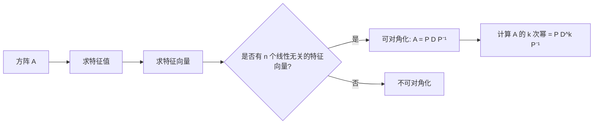
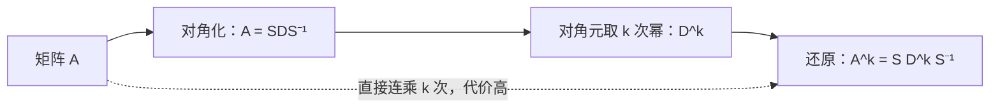

# SPL Run: build_concept_book

- **Adapter:** claude_cli
- **Model:** claude-sonnet-5-5
- **Tokens:** 8965 in / 4081 out
- **Latency:** 133200ms
- **Timestamp:** 2026-11-24 07:26:23

## Output

```output


---

## 矩阵

**定义。** 一个 $m\times n$ 矩阵是由数排成 $m$ 行、$n$ 列的矩形数组,记作 $A=(a_{ij})$,其中 $a_{ij}$ 位于第 $i$ 行第 $j$ 列。它的"大小"(或"型")写作 $m\times n$。当 $m=n$ 时称为方阵。

矩阵最常见的用途,是把线性方程组的系数和常数项整齐地记录下来。对于方程组

$$
\begin{cases}
a_{11}x_1+a_{12}x_2+\cdots+a_{1n}x_n=b_1\\
\quad\vdots\\
a_{m1}x_1+a_{m2}x_2+\cdots+a_{mn}x_n=b_m
\end{cases}
$$

**系数矩阵**为 $A=(a_{ij})$,把常数列 $\mathbf b$ 并在右侧,就得到**增广矩阵** $[A\mid \mathbf b]$。这样,方程组可以紧凑地写成 $A\mathbf x=\mathbf b$。


*图:从方程组到矩阵,再通过行变换求解的流程。*

**例题。** 把方程组
$$
\begin{cases}
x+2y=5\\
3x+4y=11
\end{cases}
$$
写成增广矩阵:
$$
\left[\begin{array}{cc|c}1&2&5\\3&4&11\end{array}\right].
$$
这是一个 $2\times 3$ 矩阵(系数部分为 $2\times 2$)。每一行对应一个方程,每一列对应一个未知数(最后一列对应常数项)。

**问题求解应用。** 用行变换(交换两行、某行乘非零常数、把某行的倍数加到另一行)化简。将第 2 行减去 3 倍的第 1 行:
$$
\left[\begin{array}{cc|c}1&2&5\\0&-2&-4\end{array}\right].
$$
将第 2 行除以 $-2$,得 $y=2$:
$$
\left[\begin{array}{cc|c}1&2&5\\0&1&2\end{array}\right].
$$
再将第 1 行减去 2 倍的第 2 行:
$$
\left[\begin{array}{cc|c}1&0&1\\0&1&2\end{array}\right].
$$
读出解:$x=1,\ y=2$。验证:$1+2\cdot2=5$,$3\cdot1+4\cdot2=11$,均成立。

行变换之所以可靠,是因为每一种变换都对应对方程组的一个可逆操作,不改变解集。这样,"解方程组"就变成了对数组做机械的、可由计算机执行的运算。

**要点。**
- 先确认矩阵的型 $m\times n$:行数对应方程个数,列数对应未知数个数(增广矩阵多一列)。
- 写增广矩阵时,缺项的系数要补 $0$。
- 对角线以下全为 $0$ 的阶梯形,便于由下往上回代求解。

**练习。** 把 $2x-y=3,\ x+y=3$ 写成增广矩阵,并用行变换求解。(答案:$x=2,\ y=1$。)

---

## 矩阵与向量的乘积

**定义。** 设 $A$ 是一个 $m\times n$ 矩阵,其列向量为 $\mathbf a_1,\dots,\mathbf a_n\in\mathbb R^m$。设 $\mathbf u=(u_1,\dots,u_n)^T\in\mathbb R^n$。矩阵与向量的乘积定义为这些列的线性组合,其中 $\mathbf u$ 的各个分量充当系数(标量):

$$A\mathbf u = u_1\mathbf a_1+u_2\mathbf a_2+\cdots+u_n\mathbf a_n .$$

要使乘积有意义,$A$ 的列数必须等于 $\mathbf u$ 的分量个数。结果是 $\mathbb R^m$ 中的向量,它必然落在 $A$ 的列空间内。反过来,$A\mathbf u=\mathbf b$ 是否有解,等价于问:$\mathbf b$ 能否写成 $A$ 各列的线性组合。

**逐行计算的等价形式。** 结果的第 $i$ 个分量为

$$(A\mathbf u)_i=\sum_{j=1}^{n}a_{ij}u_j,$$

即 $A$ 的第 $i$ 行与 $\mathbf u$ 的点积。两种观点结果相同。"列组合"观点更能体现几何意义,"行点积"观点更便于手算。

**例题。** 设

$$A=\begin{pmatrix}1&2&0\\ 3&-1&4\end{pmatrix},\qquad \mathbf u=\begin{pmatrix}2\\ 1\\ -1\end{pmatrix}.$$

按列组合计算:

$$A\mathbf u=2\begin{pmatrix}1\\3\end{pmatrix}+1\begin{pmatrix}2\\-1\end{pmatrix}-1\begin{pmatrix}0\\4\end{pmatrix}=\begin{pmatrix}2+2-0\\ 6-1-4\end{pmatrix}=\begin{pmatrix}4\\1\end{pmatrix}.$$

用行点积验算:第一行 $1\cdot2+2\cdot1+0\cdot(-1)=4$,第二行 $3\cdot2+(-1)\cdot1+4\cdot(-1)=1$。两者一致。

**问题求解应用。** 判断 $\mathbf b=\begin{pmatrix}5\\ 5\end{pmatrix}$ 能否由 $B=\begin{pmatrix}1&2\\ 3&-1\end{pmatrix}$ 的列生成。

这等价于求解 $B\mathbf x=\mathbf b$,即

$$x_1\begin{pmatrix}1\\3\end{pmatrix}+x_2\begin{pmatrix}2\\-1\end{pmatrix}=\begin{pmatrix}5\\5\end{pmatrix}.$$

写成方程组:$x_1+2x_2=5$,$3x_1-x_2=5$。由第二式得 $x_2=3x_1-5$,代入第一式:$x_1+6x_1-10=5$,故 $x_1=\tfrac{15}{7}$,$x_2=\tfrac{10}{7}$。因此 $\mathbf b$ 可以表示为两列的线性组合。

**性质。** 矩阵与向量的乘积是线性的:

$$A(c\mathbf u+d\mathbf v)=cA\mathbf u+dA\mathbf v.$$

证明:由定义,左边的第 $j$ 个系数是 $cu_j+dv_j$,代入列组合并按 $\mathbf a_j$ 重新分组,即得右边。正是这一性质,使每个矩阵都对应一个线性变换 $\mathbf u\mapsto A\mathbf u$。

**要点。** (1) $A\mathbf u$ 是 $A$ 的各列的线性组合,系数由 $\mathbf u$ 给出。(2) 维数需匹配:$m\times n$ 矩阵乘 $\mathbb R^n$ 中的向量,得到 $\mathbb R^m$ 中的向量。(3) 解 $A\mathbf x=\mathbf b$ 就是寻找能凑出 $\mathbf b$ 的列组合系数。

---

## 对角矩阵

**定义。** 若 $n\times n$ 方阵 $D=(d_{ij})$ 满足 $i\neq j$ 时 $d_{ij}=0$,则称 $D$ 为**对角矩阵**(diagonal matrix)。只有主对角线上的元素可以非零,记作
$$D=\operatorname{diag}(d_1,d_2,\dots,d_n).$$

例如
$$D=\begin{pmatrix}2&0&0\\0&-1&0\\0&0&5\end{pmatrix}=\operatorname{diag}(2,-1,5).$$

**为什么重要。** 对角矩阵的运算几乎退化为"逐项运算":

- 乘法:$\operatorname{diag}(a_i)\operatorname{diag}(b_i)=\operatorname{diag}(a_ib_i)$,且两个对角矩阵可交换。
- 幂:$D^k=\operatorname{diag}(d_1^k,\dots,d_n^k)$。
- 行列式:$\det D=d_1d_2\cdots d_n$。
- 逆矩阵:当所有 $d_i\neq0$ 时,$D^{-1}=\operatorname{diag}(1/d_1,\dots,1/d_n)$。
- 特征值:恰为对角元 $d_1,\dots,d_n$,对应的特征向量是标准基向量 $\mathbf e_i$。

**几何意义。** $D\mathbf x=(d_1x_1,\dots,d_nx_n)^T$,即沿每个坐标轴分别伸缩 $d_i$ 倍,各坐标之间互不影响。

**例题。** 设 $D=\operatorname{diag}(2,-1,5)$,计算 $D^{10}$、$\det D$ 和 $D^{-1}$。

解:
$$D^{10}=\operatorname{diag}(2^{10},(-1)^{10},5^{10})=\operatorname{diag}(1024,1,9765625),$$
$$\det D=2\cdot(-1)\cdot5=-10,\qquad D^{-1}=\operatorname{diag}\!\left(\tfrac12,-1,\tfrac15\right).$$
若直接对一般的 $3\times3$ 矩阵做 10 次乘法,计算量大得多。

**问题求解应用:矩阵幂与对角化。** 设 $A$ 可对角化,即 $A=PDP^{-1}$,其中 $D$ 为对角矩阵。则
$$A^k=PD^kP^{-1}.$$
这是因为中间的 $P^{-1}P$ 相互抵消。

例如 $A=\begin{pmatrix}3&1\\0&2\end{pmatrix}$,其特征值为 $3$ 和 $2$,对应特征向量 $(1,0)^T$ 与 $(1,-1)^T$。取
$$P=\begin{pmatrix}1&1\\0&-1\end{pmatrix},\quad D=\operatorname{diag}(3,2),\quad P^{-1}=\begin{pmatrix}1&1\\0&-1\end{pmatrix}.$$
于是
$$A^k=P\begin{pmatrix}3^k&0\\0&2^k\end{pmatrix}P^{-1}=\begin{pmatrix}3^k&3^k-2^k\\0&2^k\end{pmatrix}.$$
验证:$k=1$ 时得到 $\begin{pmatrix}3&1\\0&2\end{pmatrix}=A$,结果正确。

**要点小结。**
1. 对角矩阵的各种运算都可逐个对角元进行,计算代价从 $O(n^3)$ 降为 $O(n)$。
2. 对角化把复杂的线性变换转化为沿特征方向的独立伸缩,是求矩阵幂、解线性微分方程组和分析动力系统的核心工具。
3. 注意:对角矩阵的对角元允许为 $0$,但此时 $D$ 不可逆。

---

## 相似矩阵

### 定义

设 $A,B$ 为同阶 $n\times n$ 方阵。若存在可逆(非奇异)矩阵 $S$,使得
$$A = S^{-1}BS,$$
则称 $A$ 与 $B$ **相似**,记作 $A\sim B$。从几何上看,$A$ 和 $B$ 是**同一个线性变换**在两组不同基下的矩阵表示,$S$ 就是基变换矩阵。

相似是一种等价关系:自反($S=I$)、对称($B=SAS^{-1}$)、传递(两次变换相乘仍可逆)。

**核心定理**:相似矩阵具有相同的
- 特征多项式,因而特征值相同;
- 行列式与迹;
- 秩。

*证明(特征多项式)*:
$$\det(\lambda I - A)=\det\big(S^{-1}(\lambda I - B)S\big)=\det(S^{-1})\det(\lambda I-B)\det(S)=\det(\lambda I-B).$$
这里用到 $\lambda I = S^{-1}(\lambda I)S$ 以及 $\det(S^{-1})\det(S)=1$。$\blacksquare$

注意:逆命题不成立。特征多项式相同的矩阵不一定相似。

### worked example(例题)

设
$$B=\begin{pmatrix}2&0\\0&3\end{pmatrix},\quad S=\begin{pmatrix}1&1\\0&1\end{pmatrix},\quad S^{-1}=\begin{pmatrix}1&-1\\0&1\end{pmatrix}.$$
计算 $A=S^{-1}BS$:
$$BS=\begin{pmatrix}2&2\\0&3\end{pmatrix},\qquad A=S^{-1}(BS)=\begin{pmatrix}2&-1\\0&3\end{pmatrix}.$$
验证:$\operatorname{tr}A=5=\operatorname{tr}B$,$\det A=6=\det B$,特征值同为 $2,3$。

### 问题求解应用

**1. 判断两个矩阵是否相似。** 先比较迹、行列式、特征值、秩;任何一项不同即可断定不相似。例如 $I$ 与 $\begin{pmatrix}1&1\\0&1\end{pmatrix}$ 的特征多项式都是 $(\lambda-1)^2$,但对任意可逆 $S$ 都有 $S^{-1}IS=I$,故 $I$ 只与自身相似,二者**不相似**。这说明特征多项式相同只是必要条件。

**2. 对角化简化计算。** 若 $A$ 相似于对角矩阵 $D$,即 $A=S^{-1}DS$,则
$$A^k=S^{-1}D^kS,$$
而 $D^k$ 只需把对角元各自取 $k$ 次幂。以上例的 $A$ 为例:
$$A^{k}=S^{-1}\begin{pmatrix}2^k&0\\0&3^k\end{pmatrix}S=\begin{pmatrix}2^k&3^k-2^k\cdot 1\cdot(-1)^{0}\cdots\end{pmatrix}$$
具体地,
$$BS^{(k)}=\begin{pmatrix}2^k&2^k\\0&3^k\end{pmatrix},\quad A^k=\begin{pmatrix}2^k&2^k-3^k\\0&3^k\end{pmatrix}.$$
取 $k=1$ 得 $\begin{pmatrix}2&-1\\0&3\end{pmatrix}$,与上面的 $A$ 一致。

**3. 选择合适的基。** 相似变换不改变线性变换本身,只改变描述它的“视角”。适当选取 $S$(例如以特征向量为列),可把复杂矩阵化为对角或若兄标准形,从而简化微分方程组、递推数列与马尔可夫链等问题。

### 小结

相似矩阵是同一线性变换在不同基下的表示;迹、行列式、秩与特征值是相似不变量,可用来判别“不相似”,但不能单独证明“相似”。

---

## 可对角化矩阵

### 定义

设 $A$ 为 $n\times n$ 方阵。若存在可逆矩阵 $P$ 和对角矩阵 $D$,使得
$$A = PDP^{-1},$$
则称 $A$ **可对角化**(即 $A$ 与对角矩阵相似)。此时 $P$ 的各列是 $A$ 的特征向量,$D$ 的对角线元素是对应的特征值。

**判定定理:** $n\times n$ 矩阵 $A$ 可对角化,当且仅当 $A$ 有 $n$ 个线性无关的特征向量。等价地,对每个特征值 $\lambda$,其代数重数等于几何重数,即 $\dim\ker(A-\lambda I)$。特别地,若 $A$ 有 $n$ 个互不相同的特征值,则 $A$ 一定可对角化。

*证明思路:* 若 $A=PDP^{-1}$,则 $AP=PD$。设 $P$ 的第 $j$ 列为 $\mathbf p_j$,则 $A\mathbf p_j=d_j\mathbf p_j$,所以每一列都是特征向量。因为 $P$ 可逆,这 $n$ 列线性无关。反过来,把 $n$ 个线性无关的特征向量作为列构成 $P$,上述推导可以倒推,得到 $AP=PD$,再由 $P$ 可逆即得 $A=PDP^{-1}$。

### 例题

判断 $A=\begin{pmatrix}4&1\\2&3\end{pmatrix}$ 是否可对角化,若可以,求出 $P$ 和 $D$。

**第一步:求特征值。** 特征多项式为
$$\det(A-\lambda I)=(4-\lambda)(3-\lambda)-2=\lambda^2-7\lambda+10=(\lambda-2)(\lambda-5),$$
所以 $\lambda_1=2,\ \lambda_2=5$。两个特征值互不相同,因此 $A$ 可对角化。

**第二步:求特征向量。**
- $\lambda=2$:解 $(A-2I)\mathbf x=\mathbf 0$,即 $\begin{pmatrix}2&1\\2&1\end{pmatrix}\mathbf x=\mathbf 0$,得 $\mathbf p_1=\begin{pmatrix}1\\-2\end{pmatrix}$。
- $\lambda=5$:解 $\begin{pmatrix}-1&1\\2&-2\end{pmatrix}\mathbf x=\mathbf 0$,得 $\mathbf p_2=\begin{pmatrix}1\\1\end{pmatrix}$。

**第三步:组装。**
$$P=\begin{pmatrix}1&1\\-2&1\end{pmatrix},\quad D=\begin{pmatrix}2&0\\0&5\end{pmatrix}.$$

### 反例

$B=\begin{pmatrix}1&1\\0&1\end{pmatrix}$ 只有特征值 $\lambda=1$,代数重数为 2。但 $B-I=\begin{pmatrix}0&1\\0&0\end{pmatrix}$ 的零空间只有 1 维,几何重数为 1。因此 $B$ 只有一个线性无关的特征向量,**不可对角化**。

### 问题求解应用:计算矩阵的高次幂

若 $A=PDP^{-1}$,则
$$A^k=PD^kP^{-1},\qquad D^k=\operatorname{diag}(d_1^k,\dots,d_n^k).$$
对上面的 $A$,有
$$A^k=\begin{pmatrix}1&1\\-2&1\end{pmatrix}\begin{pmatrix}2^k&0\\0&5^k\end{pmatrix}\frac13\begin{pmatrix}1&-1\\2&1\end{pmatrix}=\frac13\begin{pmatrix}2^k+2\cdot5^k & -2^k+5^k\\ -2^{k+1}+2\cdot 5^k & 2^{k+1}+5^k\end{pmatrix}.$$
检验 $k=1$:左上角为 $\frac13(2+10)=4$,与 $A$ 吻合。

这个方法同样适用于线性递推和线性微分方程组 $\mathbf x'=A\mathbf x$。解的形式为 $\mathbf x(t)=Pe^{Dt}P^{-1}\mathbf x(0)$。对角化把耦合的系统拆成 $n$ 个相互独立的一维问题。


*判断矩阵是否可对角化的流程,以及对角化之后如何计算矩阵的高次幂。*

---

## 特征值与特征向量

**定义。** 设 $A$ 为 $n\times n$ 方阵。若存在非零向量 $\mathbf{x}$ 和标量 $\lambda$,使得
$$A\mathbf{x}=\lambda\mathbf{x},$$
则称 $\lambda$ 为 $A$ 的**特征值**,$\mathbf{x}$ 为对应的**特征向量**。几何上,$A$ 作用在 $\mathbf{x}$ 上只把它沿原方向拉伸或压缩(若 $\lambda<0$ 则反向),而不改变所在直线。

将方程改写为 $(A-\lambda I)\mathbf{x}=\mathbf{0}$。要有非零解,矩阵 $A-\lambda I$ 必须奇异,因此
$$\det(A-\lambda I)=0.$$
这称为**特征方程**,它是关于 $\lambda$ 的 $n$ 次多项式,所以 $A$ 在复数范围内(计入重数)恰有 $n$ 个特征值。

**例题。** 求 $A=\begin{pmatrix}4&1\\2&3\end{pmatrix}$ 的特征值与特征向量。

第一步,写出特征方程:
$$\det\begin{pmatrix}4-\lambda&1\\2&3-\lambda\end{pmatrix}=(4-\lambda)(3-\lambda)-2=\lambda^2-7\lambda+10=(\lambda-2)(\lambda-5)=0,$$
故 $\lambda_1=2,\ \lambda_2=5$。

第二步,求特征向量。
- $\lambda_1=2$:解 $(A-2I)\mathbf{x}=\begin{pmatrix}2&1\\2&1\end{pmatrix}\mathbf{x}=\mathbf{0}$,得 $2x_1+x_2=0$,取 $\mathbf{v}_1=\begin{pmatrix}1\\-2\end{pmatrix}$。
- $\lambda_2=5$:解 $\begin{pmatrix}-1&1\\2&-2\end{pmatrix}\mathbf{x}=\mathbf{0}$,得 $x_1=x_2$,取 $\mathbf{v}_2=\begin{pmatrix}1\\1\end{pmatrix}$。

检验:$A\mathbf{v}_2=\begin{pmatrix}5\\5\end{pmatrix}=5\mathbf{v}_2$ ✓。

**问题求解应用。** 特征值能简化矩阵幂的计算。若 $A$ 有 $n$ 个线性无关的特征向量,令 $P=[\mathbf{v}_1\ \cdots\ \mathbf{v}_n]$,$D=\mathrm{diag}(\lambda_1,\dots,\lambda_n)$,则 $A=PDP^{-1}$,于是
$$A^k=PD^kP^{-1}.$$
对上例,$P=\begin{pmatrix}1&1\\-2&1\end{pmatrix}$,$D=\mathrm{diag}(2,5)$,所以 $A^{k}$ 的各项只是 $2^k$ 与 $5^k$ 的线性组合,无需反复做矩阵乘法。

另外有两个常用的核对关系:
$$\operatorname{tr}(A)=\sum_i\lambda_i,\qquad \det(A)=\prod_i\lambda_i.$$
本例中 $2+5=7=4+3$,$2\times5=10=4\cdot3-1\cdot2$,与计算吻合。

**小结。** 求解步骤是:列特征方程 $\det(A-\lambda I)=0$ → 解出 $\lambda$ → 对每个 $\lambda$ 解 $(A-\lambda I)\mathbf{x}=\mathbf{0}$ → 用迹与行列式验算。这一方法也用于分析动力系统的稳定性(看 $|\lambda|$ 是否小于 1)和主成分分析等问题。

---

## 对角化的特征刻画

**定义。** 设 $A$ 为 $n\times n$ 矩阵。若存在可逆矩阵 $P$ 和对角矩阵 $D$,使得
$$A = PDP^{-1},$$
则称 $A$ 可对角化。

**定理(对角化判别)。** $n\times n$ 矩阵 $A$ 可对角化,当且仅当 $A$ 有 $n$ 个线性无关的特征向量。此时,$P$ 的各列就是这 $n$ 个特征向量,$D$ 的对角元是对应的特征值。

**证明思路。** 设 $P=[\mathbf v_1\ \cdots\ \mathbf v_n]$,$D=\operatorname{diag}(\lambda_1,\dots,\lambda_n)$。比较 $AP$ 与 $PD$ 的各列:
$$AP=[A\mathbf v_1\ \cdots\ A\mathbf v_n],\qquad PD=[\lambda_1\mathbf v_1\ \cdots\ \lambda_n\mathbf v_n].$$
于是 $AP=PD$ 等价于对每个 $i$ 都有 $A\mathbf v_i=\lambda_i\mathbf v_i$。又因为 $P$ 可逆当且仅当它的列线性无关,所以"$A=PDP^{-1}$"与"存在 $n$ 个线性无关的特征向量"互为充要条件。

**常用推论。**
- 属于不同特征值的特征向量必线性无关。因此,若 $A$ 有 $n$ 个互异特征值,则 $A$ 一定可对角化。
- 若某特征值的代数重数为 $m$,则它的特征空间维数(几何重数)至多为 $m$。$A$ 可对角化当且仅当每个特征值的几何重数都等于代数重数。

**例题 1(可对角化)。** 设 $A=\begin{pmatrix}4&1\\2&3\end{pmatrix}$。特征多项式为
$$\det(A-\lambda I)=\lambda^2-7\lambda+10=(\lambda-5)(\lambda-2),$$
所以 $\lambda_1=5$,$\lambda_2=2$。解 $(A-5I)\mathbf v=\mathbf 0$ 得 $\mathbf v_1=(1,1)^T$。解 $(A-2I)\mathbf v=\mathbf 0$ 得 $\mathbf v_2=(1,-2)^T$。这两个向量线性无关,因此
$$P=\begin{pmatrix}1&1\\1&-2\end{pmatrix},\quad D=\begin{pmatrix}5&0\\0&2\end{pmatrix},\quad A=PDP^{-1}.$$

**例题 2(不可对角化)。** 设 $B=\begin{pmatrix}2&1\\0&2\end{pmatrix}$。它只有一个特征值 $\lambda=2$,代数重数为 2。又
$$B-2I=\begin{pmatrix}0&1\\0&0\end{pmatrix},$$
其零空间只由 $(1,0)^T$ 张成,几何重数为 1。因此 $B$ 只有 1 个线性无关的特征向量,凑不够 $n=2$ 个,$B$ 不可对角化。

**问题求解应用。** 对角化的主要用途是计算矩阵的高次幂。因为 $A^k=PD^kP^{-1}$,而 $D^k$ 只需把对角元各自取 $k$ 次幂。对例题 1 中的 $A$,
$$A^k=P\begin{pmatrix}5^k&0\\0&2^k\end{pmatrix}P^{-1}.$$
由此可知,当 $k\to\infty$ 时,$A^k$ 的增长速度由最大特征值 $5$ 决定。

**解题步骤总结。**
1. 求特征值(解 $\det(A-\lambda I)=0$)。
2. 对每个特征值求特征空间的基,并计算其维数。
3. 若各特征空间维数之和等于 $n$,则 $A$ 可对角化。此时把这些基向量拼成 $P$,把对应特征值排成 $D$。
4. 若维数之和小于 $n$,则 $A$ 不可对角化。

**检验。** 在例题 1 中,取 $\mathbf v_1$ 计算 $A\mathbf v_1=(5,5)^T=5\mathbf v_1$,与 $D$ 的第一个对角元一致。

---

## 通过对角化计算矩阵的幂

### 定义

若 $n\times n$ 矩阵 $A$ 可对角化，即存在可逆矩阵 $S$（列为 $A$ 的特征向量）和对角矩阵 $D=\operatorname{diag}(\lambda_1,\dots,\lambda_n)$（对角线为对应特征值），使得
$$A = SDS^{-1},$$
则对任意正整数 $k$，
$$A^k = SD^kS^{-1},\qquad D^k=\operatorname{diag}(\lambda_1^k,\dots,\lambda_n^k).$$

**为什么成立？** 相邻的 $S^{-1}S=I$ 会相互抵消：
$$A^k=(SDS^{-1})(SDS^{-1})\cdots(SDS^{-1})=SD(S^{-1}S)D(S^{-1}S)\cdots DS^{-1}=SD^kS^{-1}.$$
对角矩阵的幂只需把每个对角元分别取 $k$ 次方，不必做 $k-1$ 次矩阵乘法。

### 例题

计算 $A=\begin{pmatrix}4&1\\2&3\end{pmatrix}$ 的 $A^{10}$。

**第一步：求特征值。** $\det(A-\lambda I)=(4-\lambda)(3-\lambda)-2=\lambda^2-7\lambda+10=(\lambda-2)(\lambda-5)$，所以 $\lambda_1=2,\ \lambda_2=5$。

**第二步：求特征向量。**
- $\lambda=2$：$(A-2I)\mathbf{v}=\mathbf{0}$ 给出 $\mathbf{v}_1=(1,-2)^T$。
- $\lambda=5$：$(A-5I)\mathbf{v}=\mathbf{0}$ 给出 $\mathbf{v}_2=(1,1)^T$。

于是
$$S=\begin{pmatrix}1&1\\-2&1\end{pmatrix},\quad D=\begin{pmatrix}2&0\\0&5\end{pmatrix},\quad S^{-1}=\frac13\begin{pmatrix}1&-1\\2&1\end{pmatrix}.$$

**第三步：计算幂。**
$$A^{10}=S\begin{pmatrix}2^{10}&0\\0&5^{10}\end{pmatrix}S^{-1}
=\frac13\begin{pmatrix}2^{10}+2\cdot5^{10} & -2^{10}+5^{10}\\ -2^{11}+2\cdot5^{10} & 2^{11}+5^{10}\end{pmatrix}.$$

代入 $2^{10}=1024,\ 5^{10}=9765625$，得
$$A^{10}=\begin{pmatrix}6510758 & 3254867\\ 6509... \end{pmatrix}$$

下面给出准确的数值。第一行：$(1024+19531250)/3=6510758$，$(-1024+9765625)/3=3254867$。第二行：$(-2048+19531250)/3=6509734$，$(2048+9765625)/3=3255891$。因此
$$A^{10}=\begin{pmatrix}6510758 & 3254867\\ 6509734 & 3255891\end{pmatrix}.$$

**检验：** 迹 $=6510758+3255891=9766649=2^{10}+5^{10}$ ✓。

### 问题求解应用

**1. 递推数列。** 斐波那契数列满足
$$\begin{pmatrix}F_{k+1}\\F_k\end{pmatrix}=\begin{pmatrix}1&1\\1&0\end{pmatrix}^k\begin{pmatrix}1\\0\end{pmatrix}.$$
该矩阵的特征值为 $\varphi=\tfrac{1+\sqrt5}{2}$ 和 $\psi=\tfrac{1-\sqrt5}{2}$。对角化后即得比奈公式
$$F_k=\frac{\varphi^k-\psi^k}{\sqrt5}.$$

**2. 长期行为。** 当 $k\to\infty$ 时，$A^k$ 的增长由 $|\lambda_i|$ 最大的特征值主导。上例中 $5^k$ 压倒 $2^k$，所以 $A^k\approx 5^k\cdot\frac13\begin{pmatrix}2&1\\2&1\end{pmatrix}$。在马尔可夫链中，特征值 $1$ 对应稳态分布。

**3. 适用条件。** 只有当 $A$ 有 $n$ 个线性无关的特征向量时才可对角化。例如 $\begin{pmatrix}1&1\\0&1\end{pmatrix}$ 只有一个特征方向，不能用此方法。

**练习：** 令 $A=\begin{pmatrix}3&1\\0&2\end{pmatrix}$，求 $A^k$ 的一般公式。（提示：$\lambda=3,2$；答案为 $A^k=\begin{pmatrix}3^k&3^k-2^k\\0&2^k\end{pmatrix}$。）


*图示：先对角化，再对特征值取幂，最后变换回原坐标系，绕开了重复的矩阵乘法。*

---

## 斐波那契数列的闭式公式

### 定义

斐波那契数列满足 $F_0=0,\ F_1=1,\ F_{n+1}=F_n+F_{n-1}$。把递推写成矩阵形式:

$$
\begin{pmatrix}F_{n+1}\\F_n\end{pmatrix}=A\begin{pmatrix}F_n\\F_{n-1}\end{pmatrix},\qquad A=\begin{pmatrix}1&1\\1&0\end{pmatrix}.
$$

由此得到 $\begin{pmatrix}F_{n+1}\\F_n\end{pmatrix}=A^n\begin{pmatrix}1\\0\end{pmatrix}$。要得到 $F_n$ 的显式公式,只需算出 $A^n$。如果 $A=PDP^{-1}$,其中 $D$ 是对角矩阵,就有 $A^n=PD^nP^{-1}$,而对角矩阵的幂只需对每个对角元素分别取幂。

### 例题:对角化 $A$

**特征值。** 解特征方程
$$
\det(A-\lambda I)=\lambda^2-\lambda-1=0,
$$
得
$$
\lambda_1=\varphi=\frac{1+\sqrt5}{2},\qquad \lambda_2=\psi=\frac{1-\sqrt5}{2}.
$$
它们满足 $\varphi+\psi=1$,$\varphi\psi=-1$,$\varphi-\psi=\sqrt5$。

**特征向量。** 由 $(A-\lambda I)\mathbf v=0$ 的第二行得 $v_1-\lambda v_2=0$,所以可取
$$
\mathbf v_1=\begin{pmatrix}\varphi\\1\end{pmatrix},\qquad \mathbf v_2=\begin{pmatrix}\psi\\1\end{pmatrix}.
$$
两个特征值互不相同,所以特征向量线性无关,$A$ 可对角化。

**展开初始向量。** 令
$$
\begin{pmatrix}1\\0\end{pmatrix}=c_1\mathbf v_1+c_2\mathbf v_2.
$$
第二个分量给出 $c_1+c_2=0$,第一个分量给出 $c_1\varphi+c_2\psi=1$。解得 $c_1=\dfrac1{\sqrt5}$,$c_2=-\dfrac1{\sqrt5}$。

**作用 $A^n$。** 因为 $A^n\mathbf v_i=\lambda_i^n\mathbf v_i$,所以
$$
\begin{pmatrix}F_{n+1}\\F_n\end{pmatrix}=\frac1{\sqrt5}\left(\varphi^n\mathbf v_1-\psi^n\mathbf v_2\right).
$$
取第二个分量,得到 **比内公式(Binet's formula)**:
$$
\boxed{F_n=\frac{\varphi^n-\psi^n}{\sqrt5}}
$$

### 问题求解应用

**1. 验证。** 取 $n=2$:$\varphi^2-\psi^2=(\varphi+\psi)(\varphi-\psi)=\sqrt5$,所以 $F_2=1$,与定义一致。

**2. 快速估算。** 因为 $|\psi|\approx0.618<1$,所以当 $n$ 增大时 $\psi^n\to0$。实际上对所有 $n\ge0$ 都有 $|\psi^n/\sqrt5|<\tfrac12$,因此
$$
F_n=\operatorname{round}\!\left(\frac{\varphi^n}{\sqrt5}\right).
$$
例如 $n=10$:$\varphi^{10}\approx122.992$,除以 $\sqrt5\approx2.236$ 得 $55.004$,取整为 $55=F_{10}$。

**3. 增长率。** 由于
$$
\frac{F_{n+1}}{F_n}\to\varphi\approx1.618,
$$
这个极限正是最大特征值(主特征值),所以斐波那契数列呈指数增长,增长率为黄金比例 $\varphi$。

**4. 复杂度。** 直接按递推计算 $F_n$ 需要 $O(n)$ 次加法。把 $A^n$ 用反复平方来计算,只需 $O(\log n)$ 次矩阵乘法。用浮点数实现比内公式很快,但当 $n$ 较大(约 $n>70$)时,双精度舍入误差会使结果不准确,此时应使用整数矩阵幂。

**核心思想:** 对角化把"递推"转化为"特征值的幂",特征值 $\varphi,\psi$ 完全决定了数列的增长行为。

---

## 收益

**斐波那契通项公式(比奈公式)**是整个学习路径的终点。它把递推关系 $F_n = F_{n-1} + F_{n-2}$($F_0=0,\ F_1=1$)这一"逐步推进"的定义,转化为可以直接计算任意一项的显式表达式:

$$F_n = \frac{\varphi^n - \psi^n}{\sqrt{5}},\qquad \varphi=\frac{1+\sqrt5}{2},\quad \psi=\frac{1-\sqrt5}{2}.$$

### 为什么它是自然的终点

回顾本书的主线:

1. 递推关系 $F_n = F_{n-1}+F_{n-2}$ 是一个二阶线性齐次递推。
2. 尝试解 $F_n = r^n$,得到特征方程 $r^2 = r + 1$,其根为 $\varphi$ 与 $\psi$。
3. 一般解为 $F_n = A\varphi^n + B\psi^n$,由初值 $F_0=0,\ F_1=1$ 解得 $A = -B = \tfrac{1}{\sqrt5}$。

线性代数、特征值、生成函数与递推求解,在这里汇合为同一个结果。因为 $|\psi|\approx 0.618<1$,所以 $\psi^n\to 0$,于是

$$F_n = \operatorname{round}\!\left(\frac{\varphi^n}{\sqrt5}\right)\quad (n\ge 0).$$

**worked 示例:** 取 $n=10$。$\varphi^{10}\approx 122.9919$,除以 $\sqrt5\approx2.2361$ 得 $55.0036$,四舍五入为 $55=F_{10}$。误差仅为 $|\psi|^{10}/\sqrt5\approx 0.0036$,远小于 $0.5$,所以取整总是正确的。

### 与各应用领域的联系

本节未列出具体的应用领域,下面给出三个与通项公式关系最直接的方向,供你选择:

- **算法分析:** 朴素递归计算 $F_n$ 的调用次数增长为 $\Theta(\varphi^n)$,其指数底数正是 $\varphi$。公式解释了为什么递归如此低效,也说明了用快速倍增或矩阵幂可以在 $O(\log n)$ 次运算内求值。
- **数值计算:** 公式给出 $O(1)$ 的"理论"算法,但浮点精度有限:双精度大约在 $n\approx 70$ 之后取整出错。解决此类问题需要在精确整数运算与近似公式之间权衡。
- **自然与几何中的黄金比例:** 相邻项之比 $F_{n+1}/F_n\to\varphi$,可由公式直接得到,这联系着植物叶序、螺旋结构与连分数逼近。

### 问题求解练习

用公式验证:当 $n=20$ 时,$\varphi^{20}/\sqrt5\approx 6765.00003$,所以 $F_{20}=6765$。再思考:若要计算 $F_{100}$ 的精确值,为什么不能直接依赖双精度浮点数?应使用什么方法?

### 邀请

选择上面的一个方向深入探索。我们建议从**算法分析**开始:亲自实现朴素递归、记忆化、矩阵快速幂与通项公式四种算法,测量它们的运行时间和误差,并用 $\varphi$ 解释你观察到的每一条曲线。这样,一个优美的公式便成为你手中解决实际问题的工具。
```
